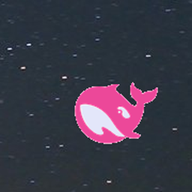
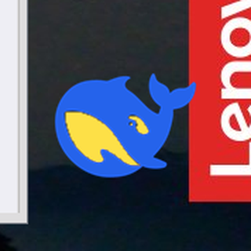
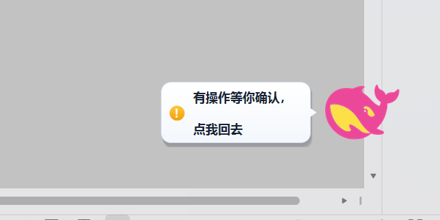
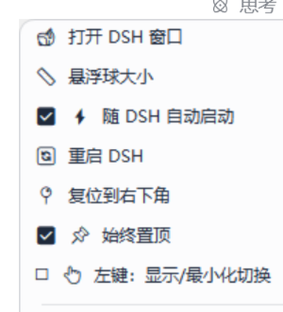

# dsh-floatball · a floating ball for DeepSeek Harness

A tiny whale that lives on your desktop, shows the pricing state of DeepSeek Harness,
and lights up when an approval is waiting for you.

> Native Windows only: PowerShell + WinForms layered window. No Electron, no extra runtime.

> ▶ [Demo video (Bilibili, 41s)](https://www.bilibili.com/video/BV1UjyfzrE46/)



## Features

- **Follows DSH**: appears when DSH starts, disappears within 20s after DSH quits (heartbeat based, not process-tree based).
- **Peak / valley colours**: red-ish during peak hours (weekdays 9–12, 14–18), blue-ish at valley (nights, weekends, public holidays).
- **Attention**: the hollow area turns bright yellow, plus a bubble, while DSH is waiting for an approval or a question answer (bubble can be turned off).
- **Click to focus**: left click brings the DSH window back, including from a minimized state.
- **Edge docking**: drop it near a screen edge to half-hide it; hover to slide out, leave to slide back (with hysteresis, no flicker).
- **Themes**: classic (blue/pink), purple, mint, amber — each with peak and valley variants.
- **Sizes**: 48 / 60 / 72 / 84 / 108 / 132 px.
- **Context menu**: open DSH, size, theme, bubble on/off, autostart with DSH, reset position, always-on-top, quit.







## Install

```bash
dsh plugin add /path/to/dsh-floatball
```

Then enable it in Plugins. The ball appears immediately, no restart needed.

## Runtime data

`%LOCALAPPDATA%\dsh-floatball\` — `settings.json`, `heartbeat.json`, `ball.log`, `plugin.log`.

## Known limits

- **Windows only.**
- **Closing DSH with ✕ hides the window.** The main window carries `WS_EX_NOREDIRECTIONBITMAP`; its pixels are committed through DirectComposition, so external `ShowWindow` / `SetWindowPos` / `SetWindowPlacement` do nothing (verified) and forcing it visible yields a blank, unclickable window. Use minimize instead, or click the tray icon.
- Edge docking is inaccurate when the taskbar is auto-hidden or moved to the top/side.

## License

MIT
