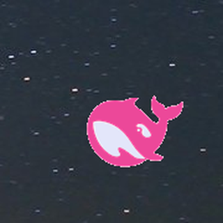
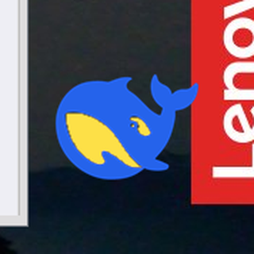
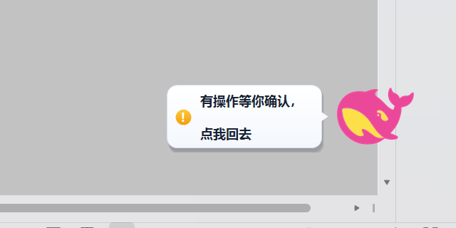
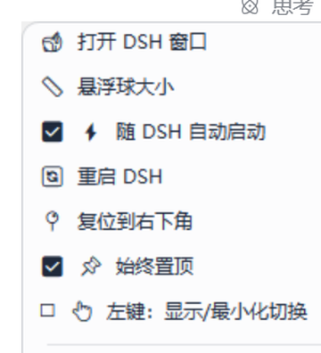

# dsh-floatball · DSH 桌面悬浮球

一只常驻桌面的小鲸鱼，显示 DeepSeek Harness 的状态，峰谷计价一眼可见，有授权等你确认时会亮起来。

> 纯 Windows 原生实现：PowerShell + WinForms 分层窗口，不需要 Electron、不需要额外运行库。



## 功能

| 功能 | 说明 |
|---|---|
| **随 DSH 启停** | DSH 启动时自动出现，DSH 退出后 20 秒内自动消失（心跳检测，不依赖进程树） |
| **峰谷配色** | 峰时（工作日 9–12、14–18）偏红/粉，谷时（夜间、周末、法定节假日）偏蓝；渐变无需重启 |
| **授权提醒** | DSH 在等你确认权限或回答问题时，镂空区域亮黄 + 气泡提示（可开关），点击气泡/球回到 DSH |
| **点击唤回** | 左键点击把 DSH 窗口唤到前台；最小化状态也能恢复 |
| **贴边半隐藏** | 拖到屏幕外边缘松手自动吸附，鼠标靠近滑出、离开滑回（带迟滞，不会抖） |
| **主题配色** | 经典（蓝/粉）、紫罗兰、薄荷绿、琥珀橙，四套主题都有峰谷两色 |
| **尺寸可调** | 右键菜单 48 / 60 / 72 / 84 / 108 / 132 px |
| **右键菜单** | 打开 DSH、悬浮球大小、主题配色、提醒气泡开关、随 DSH 自动启动、复位到右下角、始终置顶、退出 |







## 安装

```bash
# 从本地目录安装（开发态）
dsh plugin add /path/to/dsh-floatball

# 或在插件市场里搜索 dsh-floatball
```

安装后在「插件」里启用即可，球会立刻出现，无需重启 DSH。

## 使用

- **左键**：唤回 DSH 窗口（点击后 250ms 内的重复点击忽略，避免把下面的窗口带出来）
- **右键**：打开菜单
- **拖动**：移动位置；拖到屏幕左/右/上/下边缘松手即吸附
- **悬停**：放大 6%，按下缩到 94%

## 配置

运行时数据在 `%LOCALAPPDATA%\dsh-floatball\`：

| 文件 | 内容 |
|---|---|
| `settings.json` | 位置、尺寸、主题、是否自动启动、气泡开关 |
| `heartbeat.json` | 宿主心跳（球据此判断 DSH 是否还活着） |
| `ball.log` | 球自己的日志（排查问题时看这个） |
| `plugin.log` | 插件侧日志（启动、心跳、授权提醒） |

## 已知限制

- **只支持 Windows**。用的是 Win32 分层窗口 + PowerShell，没有跨平台实现。
- **点 ✕ 关闭 DSH 后无法用球唤回**。DSH 的 ✕ 是 `window.hide()`，主窗口带 `WS_EX_NOREDIRECTIONBITMAP`，画面由应用的 DirectComposition 提交，外部 `ShowWindow` / `SetWindowPos` / `SetWindowPlacement` 全部无效（实测），强行显示只会得到一张白屏。这种情况下请用最小化，或点任务栏托盘里的鲸鱼图标。
- **贴边吸附的盲区**：任务栏设为自动隐藏或放在顶部/侧边时，吸附计算会失准。

## 实现要点（给想改的人）

- `index.js`：插件入口。负责启动/回收球进程、写心跳文件、把 `approval/request` 与 `userQuestions.ask` 包一层用来点提醒。
- `ball.ps1`：球本体。分层窗口（`UpdateLayeredWindow` 逐像素 alpha，所以边缘是抗锯齿的、没有白边）、Per-Monitor DPI 感知、9 档预渲染缩放、贴边吸附、气泡渲染。
- `layered.cs.txt` / `menu.cs.txt`：内嵌 C#（编译后通过 `Add-Type` 加载），分别提供分层窗口绘制和菜单圆角自绘。

## License

MIT
